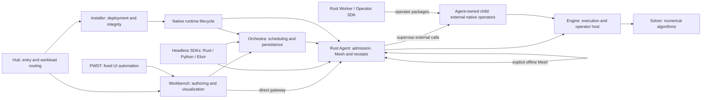

# Current Architecture Map

This is the compact navigation map for the current `daji 3.x` line, reviewed
on November 13, 2026 against the source tree, workspace Store, native admission
and recovery boundaries. It describes ownership and call paths, not installed qualification.
Version declarations belong to the manifests and [current line](current-line.md),
not a second release timeline in this navigation map.

Kyuubiki is a contract-first FEM system, not one monolithic application.
Keep product shells, control clients, runtime services, execution and numerical
kernels separate without adding a new module for every helper.

## Layer Map

Arrows show interactions, not an exhaustive Cargo dependency graph. Shared
schemas, TaskIR, digests, receipts and artifact contracts constrain these paths.
The [module topology](../config/architecture/module-topology.json) groups source
ownership and verification lanes; Cargo manifests define actual crate dependencies.
There are 13 logical topology modules and 17 Rust workspace crates. These are
different views, not missing modules or a requirement to merge executables.

## Product Shells

| Surface | Owns | Does not own |
| --- | --- | --- |
| Hub | Entry, project routing, runtime posture, documentation | Workflow editing or numerical execution |
| Workbench | Modeling, operator graphs, research workflow, visualization | Runtime installation or solver internals |
| Installer | Deployment, repair, updates, credentials and component integrity | Engineering project authoring |
| Shared desktop UI | Shared assets, bridge helpers and stable automation anchors | A fourth shell or runtime service |

The three native desktop shells remain independent applications. Share native
lifecycle logic and UI assets instead of merging their user-facing roles.
Mobile/WebView clients use remote capabilities and do not imply local Agent or
Orchestra deployment. See [app-runtime-boundaries.md](app-runtime-boundaries.md).

## Control Plane

`apps/web` owns Orchestra's scheduling, API, job persistence, workflow execution,
catalog lowering and recovery coordination. Orchestra is a managed workload,
not the whole product. Single-Agent direct use and offline Mesh do not require
routing every operation through Orchestra.

The central website/store is a named self-host service surface within the
control-plane topology, not a second platform or an additional top-level module.
Keep its service policy and deployment boundaries explicit; its existence does
not qualify native Agent authentication. See [module-architecture.md](module-architecture.md).

## Workspace Store Ownership

The Store belongs to the Workbench project workflow, not Hub and not a new
runtime engine. Reuse these owners rather than adding another plugin platform:

| Boundary | Source owner | Limit |
| --- | --- | --- |
| Catalog state and compact/expanded UI | [Store mount](../apps/frontend/src/components/workbench/workbench-store-section-mount.tsx), workspace and details components | Presentation and request ownership, not installation |
| Search, filters and page selection | [Catalog helpers](../apps/frontend/src/lib/workbench/store-catalog.ts) | Operate on catalog data, not executable packages |
| GUI/PWDT project reference mutations | [Command service](../apps/frontend/src/lib/workbench/store-command-service.ts) and [manifest](../apps/frontend/src/lib/workbench/store-manifest.ts) | One normalization/conflict policy; staging is not download or admission |
| Backend/source access | [Store adapter](../apps/frontend/src/lib/workbench/store-backend-service.ts) | Runtime-backed transport, not UI-owned account or payment logic |
| Hosted identity and download grants | [Native identity](../workers/rust/crates/desktop-runtime/src/store_identity.rs) and [downloads](../workers/rust/crates/desktop-runtime/src/store_download.rs) | Login callback, in-memory session, authorized retrieval and recovery; not Agent credentials |
| Installation, target variants and project pins | [Installer API](../workers/rust/crates/installer/src/lib.rs), [variant staging](../workers/rust/crates/installer/src/operator_variant.rs) and [project operators](../workers/rust/crates/installer/src/project_operator.rs) | Download completion is not installation, enablement or remote readiness |
| Remote package transfer and readiness | [Rust SDK driver](../workers/rust/crates/headless-sdk/src/operator_deployment.rs) and [Agent deployment](../workers/rust/crates/cli/src/operator_package_deployment.rs) | Explicit platform/version/digest/process fences; no implicit overwrite, restart or execution |
| Existing service catalog and package distribution | [Asset store](../apps/web/lib/kyuubiki_web/asset_store.ex), [central store](../apps/web/lib/kyuubiki_web/central_store.ex), [package distribution](../apps/web/lib/kyuubiki_web/operator_package_distribution_store.ex) | Existing local/managed services, not a completed hosted commerce system |

The [HTML integration handoff](operator-store-integration.html) owns the current
implementation boundary and proposed backend contract. Team Silvortex supplies
shared identity; Kyuubiki does not build another password/payment system.
Self-hosted sources do not require a vendor account. Native login/session,
authorized download, installation and project/remote deployment adapters are
implemented; their tested scopes and remaining hosted-service integration work
belong to the HTML handoff. A browser mock is not a real account/quota test.
Neither Store access nor a project reference grants Agent control.

The user-visible sequence is catalog -> authorization -> target-platform bytes
-> Installer verification -> explicit project pin -> target Agent deployment
and readiness -> TaskIR execution. A completed earlier step cannot replace the
next step's receipt, and a lost response is not permission to repeat a write.

## Runtime Data Plane

| Rust crate | Responsibility |
| --- | --- |
| `protocol` | RPC/TaskIR contracts, digests and pure shared admission rules |
| `agent-transport` | Shared native TLS/token transport, separate from task payloads and numerical execution |
| `cli` | Agent process, transport, authority, Mesh, durable receipts and native command entrypoints |
| `engine` | Reusable execution dispatch, workflow helpers and operator host |
| `solver` | Numerical kernels, accuracy gates and numerical recovery strategies |
| `operator-sdk` | Rust-only executable operator extension and ABI contracts |
| `operator-thermal-q9` | Thermal Q9 operator implementation and native ABI exports, not a second engine |
| `desktop-runtime` | Native local-service lifecycle, process ownership and runtime layout |
| `installer` | Install/update/repair, credentials, package and deployment validation |
| `platform` | Shared OS/platform primitives |
| `headless-sdk` | Rust UI-free control and research client |
| `project-automation` | Stored project automation to Headless plans and execution reports |
| `project-bundle` | Editable `.kyuubiki` project container operations |
| `kcore` | Frozen `.kcore` computation exchange |
| `deploy-server` | Native artifact delivery service |
| `benchmark` | Native solver/runtime performance lanes |
| `script-runner` | Repository operations, checks and native maintenance tools |

All crate paths above are under `workers/rust/crates/`. Independent crate
boundaries do not imply independent running processes. Engine and Solver are
linked libraries used by native execution; there is no need for a solver microservice
just to preserve ownership. External dynamic libraries have an Agent-owned
per-call process boundary, unlike in-process built-ins. The same executable
hosts the child; this does not add a separately installed service or crate.
Shared policy helpers in Protocol remain libraries.
Use [Cargo.toml](../workers/rust/Cargo.toml), not a prose count, when building.

## Execution And Recovery Path

1. GUI, PWDT-driven UI or a Headless client creates a request. Elixir/Rust task
   descriptions lower into language-neutral TaskIR, not Elixir code on the Agent.
2. The selected control path submits to Orchestra or directly to an Agent.
3. Agent validates digest, admission, capability, ownership and input contract.
4. An admitted built-in uses its native adapter; admitted solver TaskIR dispatches
   through Engine. External packages require resolution, integrity checks and
   an attached operator runtime with supervised per-call child execution.
   `execute` exists; it is not only a reserved mode.
5. Results and receipts retain execution identity and provenance. Recovery reads
   the exact original evidence; unknown outcomes never imply safe replay or
   migration to another peer.

TaskIR solver capability is narrower than the complete direct-RPC solver catalog.
The current native solver adapter admits `solve.bar_1d`, `solve.modal_frame_2d`
and `solve.modal_frame_3d`. Other native built-ins and external packages have
their own gates. Neither an operator name nor a successful preflight proves a
completed solve or production qualification. Source anchors:

- [TaskIR dispatch](../workers/rust/crates/cli/src/operator_task_runtime.rs)
- [Engine solver adapter](../workers/rust/crates/cli/src/operator_task_runtime/engine_solver.rs)
- [Runtime and recovery book](book-ch04-runtime-modes.html)

## Native Operator Host Ownership

| Responsibility | Source owner | Boundary |
| --- | --- | --- |
| Package identity and generation leases | [Runtime binding](../workers/rust/crates/cli/src/operator_package_runtime.rs) | Pins/leases, not native function pointers in the Agent |
| Process lifecycle, budgets and IPC | [Supervisor](../workers/rust/crates/cli/src/operator_package_process.rs) | One call per child, cancellation, termination and reap; no hidden retry |
| Cancellable package acquisition | [Download adapter](../workers/rust/crates/cli/src/operator_package_process/fetch.rs) | Reuses Installer in a supervised child; unpublished-generation storage, no plugin loading or new service |
| Package cache recovery coordination | [Session leases](../workers/rust/crates/cli/src/operator_package_generation_session.rs) | Agent/downloader shared leases; bounded catalog coordination; cleanup never guesses ownership from PID |
| Session initialization recovery | [Creation intent](../workers/rust/crates/cli/src/operator_package_generation_session/initialization.rs) | Persist intent before creating directories; exact metadata-prefix and lease checks; non-recursive cleanup of proven incomplete sessions |
| Child-only loading and ABI execution | [Private worker](../workers/rust/crates/cli/src/operator_package_process/worker.rs) | Private to the supervisor; no Agent listener, Store or Orchestra startup |
| Low-level registry and ABI | [Engine host](../workers/rust/crates/engine/src/operator_sdk_host.rs) | Direct embedding stays in-process; not a security sandbox |
| Crash/hang/parent-loss evidence | [Process tests](../workers/rust/crates/cli/tests/operator_process_isolation.rs) and [fault fixture](../workers/rust/crates/cli/tests/fixtures/operator_process_fault.rs) | Synthetic libraries only; never distributed as operator packages |

This is fault containment, not a malicious-code sandbox or all-platform resource
quota. Startup diagnostics, explicit repair, per-call failure and workflow replay
remain separate contracts. See the [HTML isolation boundary](operator-store-integration.html#native-process-isolation)
for limits and actual qualification rather than copying test totals into this map.

## Workflow Recovery Ownership

These are responsibility groups within Orchestra, not extra topology modules or
services. Keep the coordinator as the state-machine entrypoint; do not move its
authority into the GUI, SDK or numerical kernel.

| Boundary | Existing source owner | Must remain separate |
| --- | --- | --- |
| API calls, lifecycle messages and recovery routing | [Coordinator](../apps/web/lib/kyuubiki_web/orchestra/workflow_recovery_coordinator.ex) | Routes work; does not duplicate store transactions or numerical admission |
| Owning lease, renewal and loss | [Ownership](../apps/web/lib/kyuubiki_web/orchestra/workflow_recovery_ownership.ex) | Permission to write is not permission to replay unknown work |
| Runner monitoring and retirement | [Runners](../apps/web/lib/kyuubiki_web/orchestra/workflow_recovery_runners.ex) | A dead waiter is not proof that a remote computation stopped |
| Scan accounting and terminal/legacy reconciliation | [Scan](../apps/web/lib/kyuubiki_web/orchestra/workflow_recovery_scan.ex) | Scan completion is not task success; plain jobs without workflow data are not inferred failed |
| Execution claim and replay admission | [Dispatch guard](../apps/web/lib/kyuubiki_web/orchestra/workflow_recovery_dispatch_guard.ex) | Checkpoint/journal evidence must authorize the original attempt, not a guessed replacement |
| Completion checkpoint and publication | [Completion store](../apps/web/lib/kyuubiki_web/orchestra/workflow_completion_store.ex) | Durable staged evidence is distinct from final result publication |
| Failure, expiry and cancellation | [Failure](../apps/web/lib/kyuubiki_web/orchestra/workflow_recovery_failure.ex) and [cancellation handoff](../apps/web/lib/kyuubiki_web/orchestra/workflow_cancellation_handoff.ex) | A cancellation request or acknowledgement does not prove remote termination |
| Atomic job/result persistence | [Jobs Store](../apps/web/lib/kyuubiki_web/jobs/store.ex) and backend transactions | Job status and the exact observed runtime must commit together, not through independent writes |

Checkpoint/receipt schemas and their validators remain the contract owners.
The stores compose those checks with lease and snapshot conditions. Ordinary
exceptions are not silently reclassified as storage outages. Recovery counters,
runtime lifecycle, raw evidence retention and solver accuracy are different
contracts; one green test cannot qualify them all. See the
[terminal and legacy commit evidence](../reports/workflow-terminal-diagnostics-20261028.md)
and the [recovery source/test placement rules](project-architecture-organization.md#workflow-recovery-source-and-test-placement).

## Numerical Admission Ownership

Numerical acceptance belongs in Solver, after reconstruction and before
successful result publication. Engine dispatch/workflows and Agent/SDK clients
must not grow their own residual policy, relaxed tolerance or hidden retry.
Transport admission, TaskIR capability and numerical acceptance are different
contracts; implementing a kernel gate does not widen the TaskIR allowlist.

| Equation family | Solver owner | Admission boundary |
| --- | --- | --- |
| Coordinate zero/prescribed constraints | [Shared sparse validator](../workers/rust/crates/solver/src/linear_constraint_validation.rs) and [chain validator](../workers/rust/crates/solver/src/chain_tridiagonal_constraint_validation.rs) | Complete unknowns against pre-elimination equations; fixed values are exact data and support reactions may be nonzero |
| Directional thermal-frame supports | [Projected constraint validator](../workers/rust/crates/solver/src/thermal_frame_3d_constraint_validation.rs) | Support identities and free-direction equilibrium in restored physical coordinates |
| Transient spring Newmark steps | [Transient operator](../workers/rust/crates/solver/src/transient_spring_1d.rs) using the shared sparse validator | Full velocity increment against the original effective system before physical state/history updates |
| Nonlinear spring/contact Newton steps | [Shared nonlinear path](../workers/rust/crates/solver/src/nonlinear_spring_1d.rs) using the shared sparse validator | Full unscaled correction against the current tangent/residual before line search; every evaluated state also checks complete dimensions and fixed identity |
| Harmonic spring complex equations | [Complex original-equation validator](../workers/rust/crates/solver/src/harmonic_spring_constraint_validation.rs) and [frequency-product range helpers](../workers/rust/crates/solver/src/harmonic_spring_frequency_range.rs) | Each frequency checks complete complex state, exact support identities, the reduction map and original element/mass/load terms; dynamic coefficients and response products defer exponent restoration until all factors are combined |

These are explicitly wired consumer scopes, not automatic coverage of all
operators. A nonlinear state is not a static tangent solution; a dynamic
increment is not a static physical displacement. Family-specific reaction and
postprocessing checks remain separate from the shared equation gate.

Harmonic arithmetic has several internal owners, not separate engines. Use this
index to find source and bounded evidence; the reports retain experimental
details, limits and failures rather than duplicating them in this architecture map.

| Internal responsibility | Source and bounded evidence |
| --- | --- |
| Complex range, row replay and force restoration | [Complex arithmetic](../workers/rust/crates/solver/src/harmonic_spring_complex_range.rs); [zero cancellation](../reports/harmonic-complex-zero-cancellation-20261024.md), [near cancellation](../reports/harmonic-complex-near-cancellation-20261024.md) |
| Scaled RHS storage and conversion atomicity | [RHS adapter](../workers/rust/crates/solver/src/harmonic_spring_rhs.rs); [range](../reports/harmonic-complex-rhs-range-20261024.md), [promotion](../reports/harmonic-rhs-promotion-20261024.md) |
| Reversible coefficient preparation and weighted pivots | [Normalization](../workers/rust/crates/solver/src/harmonic_spring_normalization.rs); [coefficient admission](../reports/harmonic-coefficient-normalization-range-20261024.md), [binary normalization](../reports/harmonic-binary-normalization-20261024.md) |
| Checked accumulation of aligned parts | [Integer accumulator](../workers/rust/crates/solver/src/harmonic_spring_exact_sum.rs); [accumulation](../reports/harmonic-complex-exact-accumulation-20261024.md) |
| Axial and general complex quotient rounding | [Scalar quotient](../workers/rust/crates/solver/src/harmonic_spring_quotient.rs), [exact ratio](../workers/rust/crates/solver/src/harmonic_spring_complex_quotient.rs), [fast-path admission](../workers/rust/crates/solver/src/harmonic_spring_fast_division.rs); [axial](../reports/harmonic-quotient-rounding-20261024.md), [general](../reports/harmonic-general-division-20261024.md), [fast-path evidence](../reports/harmonic-fast-division-20261024.md) |
| Fused RHS and Schur updates, complete replayed-row division | [Row helper](../workers/rust/crates/solver/src/harmonic_spring_row_update.rs); [row update](../reports/harmonic-row-update-20261024.md), [Schur update](../reports/harmonic-schur-update-20261024.md), [replayed-row quotient](../reports/harmonic-row-quotient-20261024.md) |
| One bounded effective factor per elimination step | [Factor helper](../workers/rust/crates/solver/src/harmonic_spring_factor.rs); [compensation evidence](../reports/harmonic-factor-compensation-20261024.md) |

Range restoration must reject unrepresentable final values, not turn them into
successful zeros. Replay heuristics are not residual tolerances. Exact local
integer operations have fixed checked capacity and do not make assembly,
factorization or a whole solve exact. RHS promotion atomicity is not rollback of
earlier elimination or process-restart recovery. The shared original-equation
gate remains mandatory for its connected consumers; factor correction is bounded
and cannot silently use different effective factors for coefficient and RHS updates.

Solver unit tests own mathematical and range counterexamples. Engine integration
tests own serialized dispatch/workflow equality, gate reachability and failure
propagation. [Constraint profiles](../config/operator-validation-profiles/linear-constraints.json)
and [complex cancellation profiles](../config/operator-validation-profiles/harmonic-cancellation.json)
register commands; [tensor evidence](../config/architecture/module-function-coverage-evidence/runtime-constraint-validation.json)
binds their bounded claims. Cooperative cancellation and same-input replay are
not durable process-restart or host-power-loss evidence.

## SDK And Extension Surfaces

- Headless SDKs are Rust/Python/Elixir control clients. The official CLI is a
  consumer, not a mandatory gateway for users writing their own applications.
- Worker / Operator SDK is Rust-only and extends executable operators. It does
  not install arbitrary frontend UI or replace the Headless SDK.
- PWDT is the frontend Python WASM automation surface. Workbench hosts the full
  Pyodide console; Hub's launcher/stub and Installer's planned restricted
  diagnostics are not equivalent execution hosts.

See [headless-sdks.md](headless-sdks.md), [operator-sdk.md](operator-sdk.md) and
[the book reading paths](book-ch08-reading-paths.html).

## Authority Rules

The intended modes remain one owning Orchestra, standalone direct control, or
explicit offline Mesh. Centralized and decentralized paths share runtime
contracts; neither is a UI-dependent fallback. Operator packages are fetched
from their configured authority as needed rather than replicated in full to
every Agent.

Keep desired authority rules separate from enforced transport security. The
native listener defaults to loopback. Without API mode, explicitly allowed LAN
source IPs receive discovery-only access unless trusted LAN control is enabled;
that legacy allowance is not authentication. Opt-in API mode requires TLS,
server certificate verification and a connection-scoped token together, with
no plaintext fallback. Remote package deployment requires the authenticated
transport; drain/resume remain loopback-only. A shared token is not per-user
authorization or proof of one-Orchestra ownership. Protocol owns pure admission,
`agent-transport` owns secure I/O, and Agent enforces both. Installer/runtime preflight and Orchestra/direct-Mesh
selection consume it rather than inventing independent allowlists. Restart
validates settings before stopping services, and observed connection readiness
does not replace lease or recovery evidence. See the
[runtime ingress guide](book-ch04-runtime-modes.html#native-agent-ingress),
[API/TLS caller limits](book-ch04-runtime-modes.html#agent-api-security) and
[Agent boundary](agent-orchestrator-boundary.md#native-execution-capacity-and-orphaned-work).

## Verification Spine

- [Topology](../config/architecture/module-topology.json) owns logical modules,
  paths, relationships and verification lanes.
- [Matrix](../config/architecture/module-function-coverage-matrix.json) owns
  module/function participation.
- [Tensor](../config/architecture/module-function-coverage-tensor.json) owns
  required evidence dimensions, named scenario scopes and release targets.
- [Module architecture](module-architecture.md) explains the scoring rules;
  [current line](current-line.md) and dated `reports/` own progress and experiments.

The [November 13 calibration](../reports/tensor-recalibration-20261113.md)
is the current dated baseline, including explicit Store/native isolation scopes.
Run `make check-module-function-coverage-tensor` for the working-tree result rather
than copying a growing sequence of historical counts into this map. A successful
structural check does not imply release readiness. Local tests, same-host TCP,
installed journeys, multi-host partitions and host power loss are distinct scopes.

The active cross-shell GUI report is
`releases/usability-evidence/current/desktop-ui-validation.json`;
`make check-desktop-ui-validation` checks it against the current manifest.
Historical release reports retain their original scope. Changing report paths or
passing browser mocks does not close native deployment or backend integration gaps.

Solver experiment results remain in their original reports and current-line
index. Removing duplicate experiment narratives from this overview does not
remove tests, failures, qualification requirements or numerical acceptance gates.

## Repository And Disk Ownership

Source boundaries and cache directories solve different problems. Do not merge
Agent, Engine, SDK and desktop shells merely to reduce build artifacts.

- Versioned source, schemas, fixtures, lockfiles and retained evidence are kept.
- Incremental caches and hashed test executables are regenerable. Use the native
  `make disk-usage` preview and `make clean-dev-cache` cleanup while builds/tests
  are idle; dependency libraries, top-level tools and release bundles are retained.
- Stop confirmed orphaned test children by exact ownership before cleanup, never
  by a broad Agent/BEAM process-name match. Installed and unrelated services stay running.
- `tmp/` is mixed: reports can be temporary, but journals, SQLite files and
  execution receipts are state. Ignored by Git does not mean safe to delete.
- Installed Apps, runtime versions, credentials and server storage are separate
  scopes managed through Installer, not blanket repository cleanup.

See [project-architecture-organization.md](project-architecture-organization.md)
for the storage policy and [repository-structure.md](repository-structure.md)
for paths. This pass does not change runtime behavior, merge packages or relabel
existing evidence.
