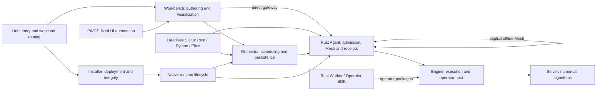

# Current Architecture Map

This is the compact navigation map for the current `daji 3.x` line, reviewed
on October 23, 2026 against the source tree and current constraint-admission
work. It describes ownership and call paths, not installed qualification.
Version declarations belong to the manifests and [current line](current-line.md),
not a second release timeline in this navigation map.

Kyuubiki is a contract-first FEM system, not one monolithic application.
Keep product shells, control clients, runtime services, execution and numerical
kernels separate without adding a new module for every helper.

## Layer Map

Arrows show interactions, not an exhaustive Cargo dependency graph. Shared
schemas, TaskIR, digests, receipts and artifact contracts constrain these paths.
The [module topology](../config/architecture/module-topology.json) groups source
ownership and verification lanes; Cargo manifests define actual crate dependencies.
There are 13 logical topology modules and 15 Rust workspace crates. These are
different views, not missing modules or a requirement to merge executables.

## Product Shells

| Surface | Owns | Does not own |
| --- | --- | --- |
| Hub | Entry, project routing, runtime posture, documentation | Workflow editing or numerical execution |
| Workbench | Modeling, operator graphs, research workflow, visualization | Runtime installation or solver internals |
| Installer | Deployment, repair, updates, credentials and component integrity | Engineering project authoring |
| Shared desktop UI | Shared assets, bridge helpers and stable automation anchors | A fourth shell or runtime service |

The three native desktop shells remain independent applications. Share native
lifecycle logic and UI assets instead of merging their user-facing roles.
Mobile/WebView clients use remote capabilities and do not imply local Agent or
Orchestra deployment. See [app-runtime-boundaries.md](app-runtime-boundaries.md).

## Control Plane

`apps/web` owns Orchestra's scheduling, API, job persistence, workflow execution,
catalog lowering and recovery coordination. Orchestra is a managed workload,
not the whole product. Single-Agent direct use and offline Mesh do not require
routing every operation through Orchestra.

The central website/store is a named self-host service surface within the
control-plane topology, not a second platform or an additional top-level module.
Keep its service policy and deployment boundaries explicit; its existence does
not qualify native Agent authentication. See [module-architecture.md](module-architecture.md).

## Runtime Data Plane

| Rust crate | Responsibility |
| --- | --- |
| `protocol` | RPC/TaskIR contracts, digests and pure shared admission rules |
| `cli` | Agent process, transport, authority, Mesh, durable receipts and native command entrypoints |
| `engine` | Reusable execution dispatch, workflow helpers and operator host |
| `solver` | Numerical kernels, accuracy gates and numerical recovery strategies |
| `operator-sdk` | Rust-only executable operator extension and ABI contracts |
| `desktop-runtime` | Native local-service lifecycle, process ownership and runtime layout |
| `installer` | Install/update/repair, credentials, package and deployment validation |
| `platform` | Shared OS/platform primitives |
| `headless-sdk` | Rust UI-free control and research client |
| `project-automation` | Stored project automation to Headless plans and execution reports |
| `project-bundle` | Editable `.kyuubiki` project container operations |
| `kcore` | Frozen `.kcore` computation exchange |
| `deploy-server` | Native artifact delivery service |
| `benchmark` | Native solver/runtime performance lanes |
| `script-runner` | Repository operations, checks and native maintenance tools |

All crate paths above are under `workers/rust/crates/`. Independent crate
boundaries do not imply independent running processes. Engine and Solver are
linked libraries used by the Agent; there is no need for a solver microservice
just to preserve ownership. The same applies to shared policy helpers in Protocol.
Use [Cargo.toml](../workers/rust/Cargo.toml), not a prose count, when building.

## Execution And Recovery Path

1. GUI, PWDT-driven UI or a Headless client creates a request. Elixir/Rust task
   descriptions lower into language-neutral TaskIR, not Elixir code on the Agent.
2. The selected control path submits to Orchestra or directly to an Agent.
3. Agent validates digest, admission, capability, ownership and input contract.
4. An admitted built-in uses its native adapter; admitted solver TaskIR dispatches
   through Engine. External packages require resolution, integrity checks and
   an attached operator runtime. `execute` exists; it is not only a reserved mode.
5. Results and receipts retain execution identity and provenance. Recovery reads
   the exact original evidence; unknown outcomes never imply safe replay or
   migration to another peer.

TaskIR solver capability is narrower than the complete direct-RPC solver catalog.
The current native solver adapter admits `solve.bar_1d`, `solve.modal_frame_2d`
and `solve.modal_frame_3d`. Other native built-ins and external packages have
their own gates. Neither an operator name nor a successful preflight proves a
completed solve or production qualification. Source anchors:

- [TaskIR dispatch](../workers/rust/crates/cli/src/operator_task_runtime.rs)
- [Engine solver adapter](../workers/rust/crates/cli/src/operator_task_runtime/engine_solver.rs)
- [Runtime and recovery book](book-ch04-runtime-modes.html)

## Numerical Admission Ownership

Numerical acceptance belongs in Solver, after reconstruction and before
successful result publication. Engine dispatch/workflows and Agent/SDK clients
must not grow their own residual policy, relaxed tolerance or hidden retry.
Transport admission, TaskIR capability and numerical acceptance are different
contracts; implementing a kernel gate does not widen the TaskIR allowlist.

| Equation family | Solver owner | Admission boundary |
| --- | --- | --- |
| Coordinate zero/prescribed constraints | [Shared sparse validator](../workers/rust/crates/solver/src/linear_constraint_validation.rs) and [chain validator](../workers/rust/crates/solver/src/chain_tridiagonal_constraint_validation.rs) | Complete unknowns against pre-elimination equations; fixed values are exact data and support reactions may be nonzero |
| Directional thermal-frame supports | [Projected constraint validator](../workers/rust/crates/solver/src/thermal_frame_3d_constraint_validation.rs) | Support identities and free-direction equilibrium in restored physical coordinates |
| Transient spring Newmark steps | [Transient operator](../workers/rust/crates/solver/src/transient_spring_1d.rs) using the shared sparse validator | Full velocity increment against the original effective system before physical state/history updates |
| Nonlinear spring/contact Newton steps | [Shared nonlinear path](../workers/rust/crates/solver/src/nonlinear_spring_1d.rs) using the shared sparse validator | Full unscaled correction against the current tangent/residual before line search; every evaluated state also checks complete dimensions and fixed identity |
| Harmonic spring complex equations | [Complex original-equation validator](../workers/rust/crates/solver/src/harmonic_spring_constraint_validation.rs) and [frequency-product range helpers](../workers/rust/crates/solver/src/harmonic_spring_frequency_range.rs) | Each frequency checks complete complex state, exact support identities, the reduction map and original element/mass/load terms; dynamic coefficients and response products defer exponent restoration until all factors are combined |

These are explicitly wired consumer scopes, not automatic coverage of all
operators. A nonlinear state is not a static tangent solution; a dynamic
increment is not a static physical displacement. Family-specific reaction and
postprocessing checks remain separate from the shared equation gate.

Harmonic [complex arithmetic](../workers/rust/crates/solver/src/harmonic_spring_complex_range.rs)
also owns exceptional elimination updates, complete-row substitution replay and
element-force product restoration. A wide temporary numerator may be divided
before restoration; an unrepresentable final coefficient, force or extension
must still fail instead of becoming a successful zero-valued result.
The [exceptional RHS adapter](../workers/rust/crates/solver/src/harmonic_spring_rhs.rs)
retains independent binary-scaled components across row normalization, elimination
and pivot swaps until solution division. Ordinary RHS storage keeps its original
allocation; coefficient preparation and pivot admission remain separate policies.
See the [bounded RHS range report](../reports/harmonic-complex-rhs-range-20261024.md).
Promotion now builds its wide buffer from an intact finite source and replaces
it only after every fallible conversion checkpoint passes. On checkpoint error,
the same adapter retains all rows and its original allocation for explicit retry;
see the [local promotion atomicity report](../reports/harmonic-rhs-promotion-20261024.md).
This does not roll back earlier matrix/RHS mutations or resume an interrupted solve.
Coefficient normalization separately rejects erased or irreversibly rounded tiny
components before elimination, with reduced-row/column/component diagnostics.
This [admission guard](../reports/harmonic-coefficient-normalization-range-20261024.md)
does not expand matrix representability or replace the original-equation check.
Nonzero component terms that cancel to a rounded zero also trigger complete
expression replay, retaining FMA product tails and earlier row-sum tails.
See the [bounded zero-cancellation report](../reports/harmonic-complex-zero-cancellation-20261024.md).
Ordinary non-cancelling arithmetic keeps its existing order; this is not a
general forward-accuracy guarantee for all nonzero cancellation.
The [near-cancellation follow-up](../reports/harmonic-complex-near-cancellation-20261024.md)
also replays strongly reduced nonzero components. Independent real/imaginary
row peaks detect gradual cancellation without row copies. The relative
`2^-26` trigger is an internal routing heuristic, not a physical residual
tolerance, singularity threshold or forward-error certificate.
Replay's [fixed integer accumulator](../workers/rust/crates/solver/src/harmonic_spring_exact_sum.rs)
retains already aligned binary64 parts without a rounded floating-point error
balance. Checked capacity and one final rounding prevent nested-tail loss;
see the [scoped accumulation report](../reports/harmonic-complex-exact-accumulation-20261024.md).
This does not make assembly, alignment or subsequent division exact.
The [row-normalization policy](../workers/rust/crates/solver/src/harmonic_spring_normalization.rs)
prefers exact binary shifts before elimination, falling back to the legacy
divisor when a tiny coefficient would otherwise be lost. Row weights travel
with pivot swaps so comparison units remain tied to each original row maximum.
See the [bounded preparation report](../reports/harmonic-binary-normalization-20261024.md);
this does not certify exact factorization or all weak-response components.
Exceptional purely real/imaginary divisors use independent scaled scalar
quotients rather than squared complex denominators. The
[near-underflow quotient helper](../workers/rust/crates/solver/src/harmonic_spring_quotient.rs)
rounds directly to quantum units using bounded integer arithmetic, retaining
the nonzero-to-zero rejection policy. See the
[public readback and cancellation report](../reports/harmonic-quotient-rounding-20261024.md);
this does not by itself remove general complex numerator/denominator rounding.
The exceptional general-divisor path now uses a separate
[bounded exact-ratio helper](../workers/rust/crates/solver/src/harmonic_spring_complex_quotient.rs).
It retains both products as integers and rounds each final component once,
without first restoring tiny squared terms or rounding a reciprocal. See the
[range, public readback and cancellation report](../reports/harmonic-general-division-20261024.md).
Its checked fixed capacity is not arbitrary precision. The ordinary divisor
path now uses a [compact integer-pair candidate](../workers/rust/crates/solver/src/harmonic_spring_fast_division.rs)
and exact rounding-cell midpoint comparisons before admitting normal components.
An FMA-refined candidate is not trusted without that check; capacity, subnormal
and ambiguous cases retain checked exact replay. Shared product decoding serves
both branches. See the [fast-path evidence](../reports/harmonic-fast-division-20261024.md).
Ordinary division bits may change; standalone product/legacy-difference bits and
numerical gates do not. RHS elimination and back-substitution numerator updates
now have a separate [fused row helper](../workers/rust/crates/solver/src/harmonic_spring_row_update.rs).
Its upward-padded local FMA rounding estimate selects complete-expression replay
when partial-sum loss is amplified relative to the final numerator. The eight
epsilon budget is an internal routing rule, not physical admission. See the
[weak-response and cancellation evidence](../reports/harmonic-row-update-20261024.md).
Schur coefficient updates now enter a separate `matrix_difference` wrapper that
reuses the same fused/replay policy for dense cells, path diagonals and generated
fill-in. See the [coefficient-tail and soft-mode evidence](../reports/harmonic-schur-update-20261024.md).
This intentionally changes coefficient-update bits, not the weighted pivot floor,
standalone product/difference semantics or operator contracts. Assembly, factors
and updated coefficients remain rounded. Ordinary fused rows still divide a
represented numerator. For replayed substitution rows, the admitted integer sums
now pass directly to the checked quotient machinery without intermediate numerator
rounding. See the [complete replayed-row quotient evidence](../reports/harmonic-row-quotient-20261024.md).
The unchanged alignment guards bound that local expression guarantee; it is not a
correct-rounding guarantee for ordinary rows or a global solution certificate.
An [elimination-step factor](../workers/rust/crates/solver/src/harmonic_spring_factor.rs)
now carries a rounded value plus a residual-quotient correction through both
matrix and RHS updates. It is transient, not a stored factor snapshot. Nonzero
inputs and update operands must fit the conservative `2^-100` to `2^100`
compensation headroom. Shared preflight disables correction for the whole step
if any updated coefficient or RHS operand is unsupported, preserving one effective
factor and the prior range-checked path, including wide RHS values.
See the [non-dyadic factor evidence](../reports/harmonic-factor-compensation-20261024.md).
The correction is approximate and bounded, not an exact factor or a general
conditioning-independent solution certificate.

Solver unit tests own mathematical and range counterexamples. Engine integration
tests own serialized dispatch/workflow equality, gate reachability and failure
propagation. [Constraint profiles](../config/operator-validation-profiles/linear-constraints.json)
and [complex cancellation profiles](../config/operator-validation-profiles/harmonic-cancellation.json)
register commands; [tensor evidence](../config/architecture/module-function-coverage-evidence/runtime-constraint-validation.json)
binds their bounded claims. Cooperative cancellation and same-input replay are
not durable process-restart or host-power-loss evidence.

## SDK And Extension Surfaces

- Headless SDKs are Rust/Python/Elixir control clients. The official CLI is a
  consumer, not a mandatory gateway for users writing their own applications.
- Worker / Operator SDK is Rust-only and extends executable operators. It does
  not install arbitrary frontend UI or replace the Headless SDK.
- PWDT is the frontend Python WASM automation surface. Workbench hosts the full
  Pyodide console; Hub's launcher/stub and Installer's planned restricted
  diagnostics are not equivalent execution hosts.

See [headless-sdks.md](headless-sdks.md), [operator-sdk.md](operator-sdk.md) and
[the book reading paths](book-ch08-reading-paths.html).

## Authority Rules

The intended modes remain one owning Orchestra, standalone direct control, or
explicit offline Mesh. Centralized and decentralized paths share runtime
contracts; neither is a UI-dependent fallback. Operator packages are fetched
from their configured authority as needed rather than replicated in full to
every Agent.

Keep desired authority rules separate from enforced transport security. The
native listener currently defaults to loopback and admits configured source
IPs, but this is not TLS or cryptographic peer/controller authentication.
Agent, Installer and runtime preflight share the policy parser. Managed restart
validates that policy before stopping existing services; status distinguishes
configuration from the policy observed on a running process. See the
[bounded containment and preflight evidence](../reports/agent-network-access-20261016.md).

## Verification Spine

- [Topology](../config/architecture/module-topology.json) owns logical modules,
  paths, relationships and verification lanes.
- [Matrix](../config/architecture/module-function-coverage-matrix.json) owns
  module/function participation.
- [Tensor](../config/architecture/module-function-coverage-tensor.json) owns
  required evidence dimensions, named scenario scopes and release targets.
- [Module architecture](module-architecture.md) explains the scoring rules;
  [current line](current-line.md) and dated `reports/` own progress and experiments.

The October 16 calibration remains the dated baseline. Run
`make check-module-function-coverage-tensor` for the working-tree result rather
than copying a growing sequence of historical counts into this map. A successful
structural check does not imply release readiness. Local tests, same-host TCP,
installed journeys, multi-host partitions and host power loss are distinct scopes.

Solver experiment results remain in their original reports and current-line
index. Removing duplicate experiment narratives from this overview does not
remove tests, failures, qualification requirements or numerical acceptance gates.

## Repository And Disk Ownership

Source boundaries and cache directories solve different problems. Do not merge
Agent, Engine, SDK and desktop shells merely to reduce build artifacts.

- Versioned source, schemas, fixtures, lockfiles and retained evidence are kept.
- Incremental caches and hashed test executables are regenerable. Use the native
  `make disk-usage` preview and `make clean-dev-cache` cleanup while builds/tests
  are idle; dependency libraries, top-level tools and release bundles are retained.
- `tmp/` is mixed: reports can be temporary, but journals, SQLite files and
  execution receipts are state. Ignored by Git does not mean safe to delete.
- Installed Apps, runtime versions, credentials and server storage are separate
  scopes managed through Installer, not blanket repository cleanup.

See [project-architecture-organization.md](project-architecture-organization.md)
for the storage policy and [repository-structure.md](repository-structure.md)
for paths. This pass does not change runtime behavior, merge packages or relabel
existing evidence.
